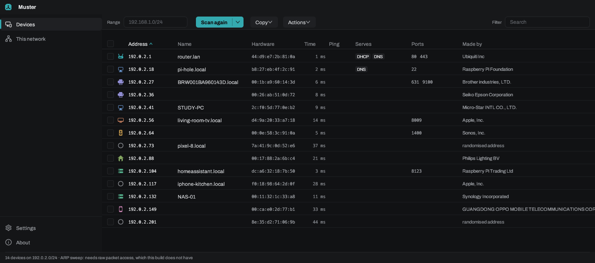
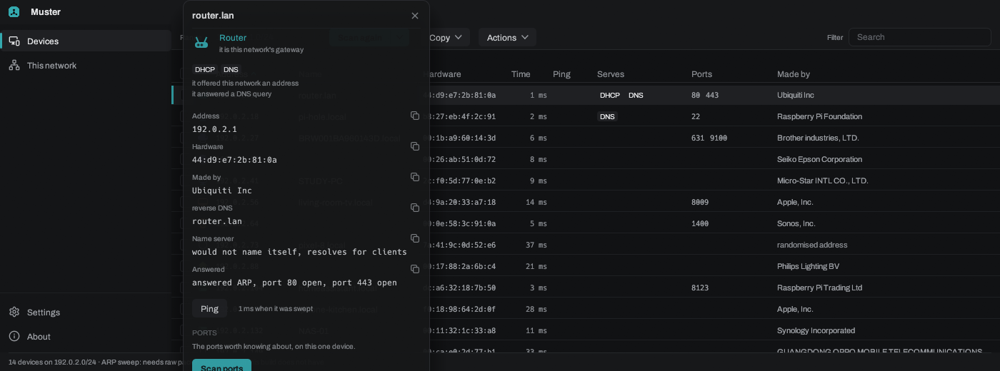
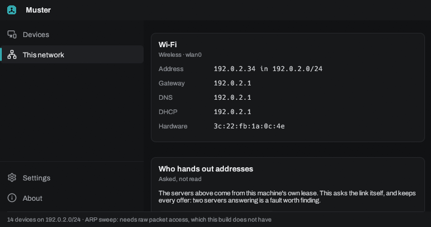
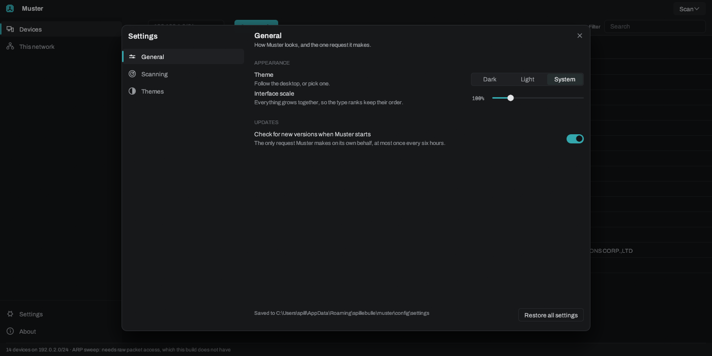

<p align="center">
  <picture>
    <source media="(prefers-color-scheme: light)" srcset="docs/images/banner-paper.png">
    
  </picture>
</p>

<p align="center">
  A network scanner built for one thing above all others: <b>the network you
  are actually on</b>. What is here, what it is, and what it is offering.
</p>

<p align="center">
  Runs as an ordinary user · names devices from mDNS, SSDP, NetBIOS and DNS ·
  finds the network's own DHCP and DNS servers · vendors from the IEEE
  registry, compiled in · nothing about your network leaves the machine
</p>


> **Early days.** The survey, the sweep, naming, device kinds, the port scan and
> the DHCP check all work, on Windows and Linux, without administrator rights.
> The fast SYN scan is not built yet, and the port scan opens a connection per
> port until it is. [What is not there yet](#what-is-not-there-yet) is honest
> about the rest.

## Install

**Muster 0.0.10.** Take the file for your system, or browse the
[release itself](https://github.com/Spillebulle/muster/releases/latest) for the
notes and the checksums.

| Your system | x86-64 | ARM64 |
|---|---|---|
| Windows | [Installer](https://github.com/Spillebulle/muster/releases/download/v0.0.10/muster-setup-0.0.10-x64.exe) | [Installer](https://github.com/Spillebulle/muster/releases/download/v0.0.10/muster-setup-0.0.10-arm64.exe) |
| Debian, Ubuntu, Mint | [`.deb`](https://github.com/Spillebulle/muster/releases/download/v0.0.10/muster_0.0.10_amd64.deb) | [`.deb`](https://github.com/Spillebulle/muster/releases/download/v0.0.10/muster_0.0.10_arm64.deb) |
| Fedora, RHEL, openSUSE | [`.rpm`](https://github.com/Spillebulle/muster/releases/download/v0.0.10/muster-0.0.10-1.x86_64.rpm) | [`.rpm`](https://github.com/Spillebulle/muster/releases/download/v0.0.10/muster-0.0.10-1.aarch64.rpm) |
| Arch | [`.pkg.tar.zst`](https://github.com/Spillebulle/muster/releases/download/v0.0.10/muster-bin-0.0.10-1-x86_64.pkg.tar.zst) | not built |
| Any other Linux | [AppImage](https://github.com/Spillebulle/muster/releases/download/v0.0.10/Muster-0.0.10-x86_64.AppImage), one file with nothing to install | [AppImage](https://github.com/Spillebulle/muster/releases/download/v0.0.10/Muster-0.0.10-aarch64.AppImage) |
| Flatpak | [`.flatpak` bundle](https://github.com/Spillebulle/muster/releases/download/v0.0.10/muster-0.0.10-x86_64.flatpak) | not built |
| Windows, `.msi` to deploy | [`.msi`](https://github.com/Spillebulle/muster/releases/download/v0.0.10/muster-0.0.10-x64.msi) | [`.msi`](https://github.com/Spillebulle/muster/releases/download/v0.0.10/muster-0.0.10-arm64.msi) |
| Windows, no installer | [`.zip`](https://github.com/Spillebulle/muster/releases/download/v0.0.10/muster-0.0.10-x86_64-pc-windows-msvc.zip) | [`.zip`](https://github.com/Spillebulle/muster/releases/download/v0.0.10/muster-0.0.10-aarch64-pc-windows-msvc.zip) |
| Linux, no package | [`.tar.gz`](https://github.com/Spillebulle/muster/releases/download/v0.0.10/muster-0.0.10-x86_64-unknown-linux-gnu.tar.gz) | [`.tar.gz`](https://github.com/Spillebulle/muster/releases/download/v0.0.10/muster-0.0.10-aarch64-unknown-linux-gnu.tar.gz) |

The `.deb` and `.rpm` add the [Spillebulle archive](https://spillebulle.github.io/packages/)
as they install, so `apt upgrade` or your usual system update carries Muster along
with everything else. Nothing to configure.

To add the archive first and install from it, or on a machine that installed
Muster before 0.0.9, on Debian, Ubuntu, Mint and Pop!_OS:

```sh
curl -fsSL https://spillebulle.github.io/packages/spillebulle-archive.asc \
  | sudo gpg --dearmor -o /usr/share/keyrings/spillebulle-archive.gpg
sudo tee /etc/apt/sources.list.d/spillebulle.sources >/dev/null <<'EOF'
Types: deb
URIs: https://spillebulle.github.io/packages/deb/
Suites: ./
Signed-By: /usr/share/keyrings/spillebulle-archive.gpg
EOF
sudo apt update && sudo apt install muster
```

On Fedora, RHEL and openSUSE:

```sh
sudo rpm --import https://spillebulle.github.io/packages/spillebulle-archive.asc
sudo tee /etc/yum.repos.d/spillebulle.repo >/dev/null <<'EOF'
[spillebulle]
name=Spillebulle
baseurl=https://spillebulle.github.io/packages/rpm/
enabled=1
gpgcheck=1
repo_gpgcheck=1
gpgkey=https://spillebulle.github.io/packages/spillebulle-archive.asc
EOF
```

There is nothing to configure and nothing to elevate. Muster scans as whatever
user you started it as, and the window needs a GPU with Vulkan or Direct3D 12,
which is any machine from the last decade. The Linux packages pull in the
libraries the window opens at runtime; the text mode needs none of them and
runs happily over SSH.

Muster can check for new versions when it starts. It asks you before the first
check, and you can change the answer in **About**. That request is the only one
Muster ever makes on its own behalf, and it goes out at most once every six
hours, because GitHub allows sixty an hour from one address and a scanner gets
opened a great deal more often than that.

## The device list



This is the application. Every device the sweep found, with the name it gave for
itself, how long it took to answer, what it serves, what it has open, and who
made its network hardware. Figures are monospaced and the columns line up,
because the point of a table of addresses is reading down it.

| Column | What it holds |
|---|---|
| Time | How long the device took to answer the sweep that found it. |
| Ping | The last re-check's round trip. Blank until you ask for one, so it never claims a measurement it did not take. |
| Serves | What answered a service question: see [What a device serves](#what-a-device-serves). |
| Ports | Every port known open: what the sweep's own knock found, and whatever a port scan has added since. A blank cell means nothing has looked, not that nothing is open. |

The vendor comes from the IEEE registry compiled into the binary, so it works
with no internet connection and no lookup service. **A randomised hardware
address is reported as randomised**, not as an unknown vendor. Every modern
phone sets one per network, and calling that "unknown" makes the list look
broken to the people who know most.

## What each device is

Every device that answered gets a kind and an icon: router, computer, server,
printer, phone, television, speaker, camera, console, smart home, network gear,
payment terminal. The guess comes from the services a device advertises over
mDNS and UPnP, then the model it names for itself, then the ports it answers
on, then who made its hardware, and last what the network card inside it is.
The row's tooltip says which of those it was, every time.

**A device's name is not one of them**, and that is on purpose. A name is the
one piece of evidence a person types, so `HP-Printer` is usually a printer and
`daves-old-printer-pc` is a desktop. A device that says nothing for itself is
left as unknown rather than named from its hostname: a blank row is an answer,
and it is the honest one.

Most devices will tell you what they are if they are asked the right question,
so Muster asks several: what is your name, what services do you offer, what
model are you, and what does your UPnP stack announce. Two of those go to the
whole network at once rather than to each device, because a great many devices
answer a question broadcast to the link and ignore the same question addressed
to them alone. A television that answers only that one still gets a
television's icon.

**The machine you are sitting at is on the list too**, and it is the one device
that answers none of the questions, because a machine's own responders do not
reply to its own packets. It is named for what it is rather than left blank.

**A device that said nothing is shown as unknown**, not guessed at. A hostname
is never used as evidence: `HP-Printer` is usually a printer and sometimes
somebody's desktop, and a name is evidence about whoever set the device up.

## What a device serves

Beside the kind, a device carries badges for what it does **for** the rest of
the network. The two are independent: a router is a router and also the DHCP
server and also the resolver, and no single label says all three.

| Badge | What earned it |
|---|---|
| `DHCP` | It offered an address in reply to a DISCOVER. |
| `DNS` | It answered a DNS query. The device window adds the software where it named itself — `dnsmasq-pi-hole-v2.93` — and whether it resolves for clients or serves its own zones only. |
| `SMB` | It answered the negotiate an SMB client sends first, on port 445: a Windows share, a NAS, or Samba. |
| `NFS` | It answered an NFS null call on port 2049 — the no-op the protocol defines, which asks a server to do nothing and reply. |
| `SSH` | It greeted a connection on port 22. The device window shows the greeting, which is the software in the server's own words. |

**Every one is a service that answered**, not an open port and not a guess from
a vendor. The DNS question is `version.bind`, which a name server answers out of
itself; where a server ignores that, the fallback asks for `localhost` and
nothing else, because a question put to somebody else's resolver must not carry
anything about the network being scanned. Nothing is opened, listed or
authenticated: the SMB and NFS questions are each protocol's own opening move,
and the SSH one sends nothing at all and reads the line the server volunteers.

## What a scan asks

The arrow at the right of the **Scan** button opens what a scan does, as against
where it goes: whether to identify devices, and which of the services above to
ask about, and how many probes a second. It stays open while you set it, and
closes when you click outside it or press **Scan** at its foot.

Everything past identification is off until you turn it on. A DISCOVER asks
every server on the link to reserve an address — nothing takes the offer and it
is given back within seconds — and the three connected questions leave a line in
somebody's log where a datagram does not. Asking is a thing to decide rather
than a thing that happens. Two DHCP servers answering is the fault this finds,
and it is one of the hardest faults on a network to see by hand.

The settings are remembered, they are the same settings as the Scanning page
under **Settings** at the foot of the sidebar, and a scan already running keeps
the settings it started with.

## Sorting

Every column heading sorts, including the icon column: click to sort, click
again to reverse. Sorting by kind is how forty rows become "the three
printers"; sorting by what a device serves brings the network's own
infrastructure to the top. Addresses sort as numbers rather than as text, so
`.9` comes before `.10`, and a row with nothing in the sorted column stays at
the bottom either way.

## Marking devices, and doing something with them

Every row has a box at its left, and the box in the heading marks everything the
filter is showing. Filter to `printer`, tick the heading, and you have marked
the printers.

**Copy** takes one column of the marked devices to the clipboard, one value per
line: the addresses for a firewall rule, the hardware addresses for a set of
DHCP reservations, or the whole row tab separated for a spreadsheet. A pill at
the foot of the window says how many of what was copied.

**Actions** does something to them:

- **Ping**, once, which fills the Ping column for every marked device.
- **Ping until stopped**, which goes round and round at the polite rate until
  you stop it. The status bar says which round it is on.
- **Scan ports**, one device at a time. That is the rate limiter's rule rather
  than a shortage of threads: two scans at once would each get half the budget
  and both would report a machine as more filtered than it is. What each scan
  finds lands in that device's Ports column and stays there.

With nothing marked, both menus act on every device the filter is showing, and
they say which above the list so it is never a guess.

## One device, in full



Click a device and a window opens with everything known about it: what Muster
thinks it is and why, what it serves the network, its address, hardware and
vendor, what it advertises, and a button to ask it again. Every field has a copy
control, because every field is something about to be pasted somewhere.

Scan its ports from the same window. Open ports are listed with the service
usually found on them, which is a convention rather than something the device
said. **Closed and filtered are counted separately and always.** Rolling them
together into "not open" is the collapse that turns a firewall into a fact.

## Finding things

Devices appear as they answer rather than when the sweep ends, so a large range
fills as it goes instead of showing nothing for a minute.

The filter matches everything a row shows: address, name, hardware address,
vendor and kind. Searching `epson`, `printer` or `192.168.1.5` all work. The
range field takes anything shaped like `10.0.0.0/24`; leave it empty and Muster
sweeps the network this machine is on and nothing beyond it.

## A second DHCP server

Two servers handing out addresses is one of the few faults on a home or office
network that is nearly always real, and one of the hardest to find by hand: it
breaks addressing intermittently and for some devices only. Muster asks by
broadcasting a DISCOVER and collecting **every** offer rather than the first,
then names each server that answered. It never accepts an offer.

Ask from **This network**, or turn it on under **Scan** in the top bar and every
scan asks. Both send the same question through the same engine, both show the
answer on the same screen, and a server that offered gets a `DHCP` badge on its
row in the device table.

It needs port 68 to hear the replies, which is not a port a program simply
gets. On Linux it is below 1024, so binding it needs `CAP_NET_BIND_SERVICE`:
**the `.deb`, the `.rpm` and the Arch package grant that on install**, so a
packaged Muster can ask. A tarball, an AppImage or a development build cannot,
and the fix is one command:

```sh
sudo setcap cap_net_bind_service,cap_net_raw=+ep /path/to/muster
```

`cap_net_raw` is in the same command because `setcap` replaces a binary's
capabilities rather than adding to them, and it is the one the ICMP echo falls
back to; granting the port alone would take the echo away.

The machine's own DHCP client is usually on port 68 already. Muster asks to
share it, which the Linux clients allow; on Windows the port belongs to the
DHCP Client service and Muster will not take it from the service this machine's
address depends on. Where it cannot have the port, it says so, and says which of
the reasons it was, rather than reporting that nobody answered.

## What counts as found

A device that **refuses** a connection has proved it is there just as surely as
one that accepts it. Muster counts both, which is how it sees the many machines
that ignore ping and answer a knock with a refusal.

Silence is the opposite: it proves nothing at all. An address that never
answered is not reported as empty, and a port that never answered is reported as
filtered rather than closed. That distinction is the most common lie a scanner
tells, and the status bar names anything the sweep could not do rather than
presenting a short list as the whole answer.

## This network



Everything the machine already knows, read straight from the operating system
with no packets sent and no privileges needed. **One card per network**, and
every card answers the same questions: the address and the prefix it sits in,
the gateway out of that link, the resolvers, the server that gave you the lease,
and the hardware address.

Per network rather than one long list, because on a laptop with a VPN up, or one
on wifi and Ethernet at once, "which gateway belongs to which link" is exactly
what somebody is here to find out. Where the platform keeps a resolver list per
interface — Windows does — the card shows that interface's; where it keeps one
list for the machine, the card says so rather than claiming it is the link's.

It answers "what is my gateway, what is my DNS" the moment the window opens, so
it is useful on its own rather than as a preamble to a scan.

## The text mode

The same engine, in the same binary, printing aligned tables. No display server
required, so it works over SSH.

| Command | What it does |
|---|---|
| `muster` | Opens the window |
| `muster survey` | What this machine knows. No packets sent |
| `muster scan` | Sweeps the network this machine is on |
| `muster scan 10.0.0.0/24` | Sweeps a prefix you name |
| `muster ports 192.0.2.18` | The ports worth knowing about, on one host |
| `muster ports 192.0.2.18 1-1024` | A range you name |

## Settings



Theme, interface scale, how hard a scan knocks, which ports it tries. Settings
save as you change them, so there is nothing to confirm and nothing to lose.

Muster reads the same `.umbertheme` files as the rest of the family, so a theme
made in a sibling application opens here. Put them in the themes folder the
Themes page names.

## Conduct

Muster is a tool for a network you are on, and the defaults keep it that way.
The default target is the prefix this machine sits in, never a range somebody
typed and never anything beyond the link. Scanning something else is a
deliberate act you have to ask for.

Muster identifies services. It does not authenticate to them, does not try
credentials, and carries nothing intended to make anything crash. Reading a
banner and asking a device its name is the whole of the interaction.

How the scan is put together, and why an unanswered probe is never reported as
a closed port, is in [`docs/architecture.md`](docs/architecture.md).

## What is not there yet

- **The fast port scan.** The stateless SYN scan needs raw packet access, which
  means Npcap on Windows and `CAP_NET_RAW` on Linux. Until it lands the port
  scan opens one connection per port: correct, unprivileged, and slower by a
  large factor. The result says which one produced it.
- **The privileged engine generally.** No ARP sweep, no SYN scan, no passive
  fingerprinting, no LLDP or CDP. The Linux packages grant `CAP_NET_RAW` for
  the one thing that does spend it — the ICMP echo, below — and
  `CAP_NET_BIND_SERVICE` for the DHCP check. Promiscuous mode, which the
  passive half of that engine will want, needs `CAP_NET_ADMIN` beside them and
  is not granted.
- **IPv6 sweeping.** Addresses, routes and gateways are read and shown for both
  families, but a sweep walks IPv4 addresses. An IPv6 prefix is not swept
  address by address, and the scan says so instead of reporting nothing found.
- **The UPnP description, TLS certificates, UDP service probes.** SSDP now
  answers: Muster reads the headers a device replies with, which carry its
  product and the kinds of device it is. It does not yet fetch the XML
  description those headers point at, which is where the manufacturer, the
  full model name and often a serial number are written.
- **The DHCP check sometimes cannot run**, on Windows where the system's own
  DHCP client already holds port 68, and on an unpackaged Linux build that was
  never granted the capability to bind it. It says which, rather than reporting
  that nobody answered.
- **ICMP echoes need the kernel's permission on Linux**, through
  `net.ipv4.ping_group_range`. Debian, Ubuntu and Pop!_OS leave it shut, so
  Muster falls back to a raw socket, which is what `CAP_NET_RAW` buys and what
  the packages grant. An AppImage cannot hold a capability at all and a tarball
  has not been granted one, so on those `sudo` is the difference between times
  and none. Where neither is open, the scan and the Ping button say no echo was
  sent and name the cure: a device is never reported as silent for a question
  that was not asked.
- **Saved scans and monitoring.** Nothing is written to disk, so two scans of
  the same network a week apart cannot yet be compared.
- **macOS.** Not a target, and not planned.

## Building from source

```sh
git clone https://github.com/Spillebulle/muster
cd muster
cargo run --release          # the window
cargo test                   # everything; no test touches a network
```

## Licence

GPL-3.0-or-later; see [LICENSE](LICENSE). The interface is set in
[Archivo](https://github.com/Omnibus-Type/Archivo) under the SIL Open Font
License, and its icons are [Lucide](https://lucide.dev), copyright Lucide Icons
and Contributors, under the ISC licence. Hardware vendor names come from the
IEEE MA-L, MA-M and MA-S registry.
